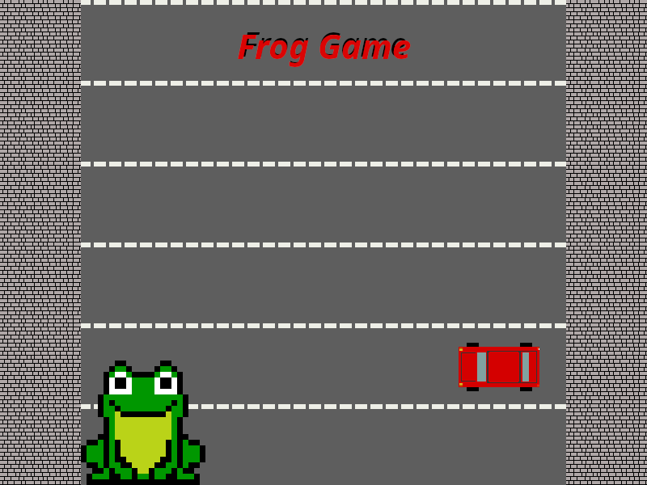
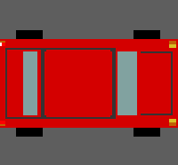
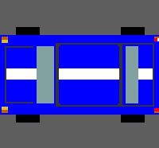
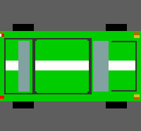

# Frog Game

An endless road-crossing arcade game written in **C** for the **MINIX 3** operating system, with **our own device drivers** for the timer, keyboard, mouse and graphics card. The player guides a frog across lanes of traffic: the road scrolls as the frog moves forward, cars drive through each lane, and the score and high score are drawn on screen.

Built by a team of 4 as the final project of the Computer Laboratory course (L.EIC, FEUP, 2024/25). Project grade: **15.6/20**.

<p align="center">
  
</p>

<p align="center">
  
  
  
  
</p>

## Highlights

- **Device drivers written from scratch** for the i8254 timer, the i8042 keyboard and mouse controller, and the graphics card through the VESA BIOS Extensions (VBE)
- **Interrupt-driven game loop** in MINIX: the game subscribes to timer, keyboard and mouse interrupts and reacts to each one
- **Graphics mode 0x115** (800x600, 24-bit colour) with XPM sprites and transparency
- **Mouse-driven menu** with play, instructions and exit buttons
- **Scrolling lanes**: new lanes are generated as the frog advances, and lanes that leave the screen are freed
- **Score and persistent high score**

## Project structure

```
src/
├── main.c, game.c        # Entry point, menu and game loops
├── I_O/                  # Timer, keyboard, mouse and video card drivers
├── classes/              # Player, lanes, cars, tunnels, menu, sprites and points
└── sprite_images/        # XPM sprites
```

## My contribution

- Implemented the **persistent high score**: it is saved to a file, loaded at start-up and drawn on screen with digit sprites
- Created the **car sprites** used in the lanes

## Running

The game runs inside the MINIX 3 virtual machine provided by the course, with the LCOM framework (`lcom_run`):

```bash
cd src
make
lcom_run proj
```

Press **ESC** to quit.

## Team

António Miller, Fábio Rocha, Hugo Alves, José Torres
